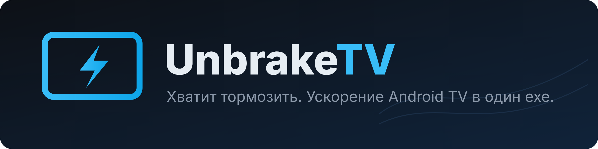
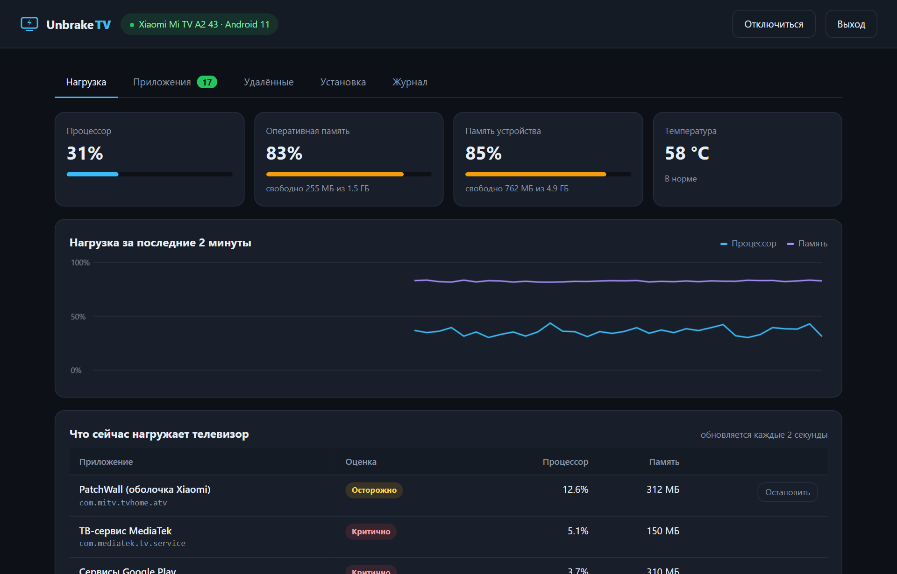
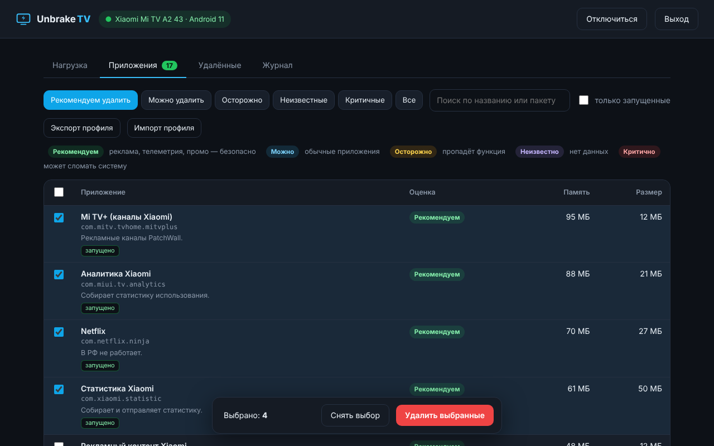
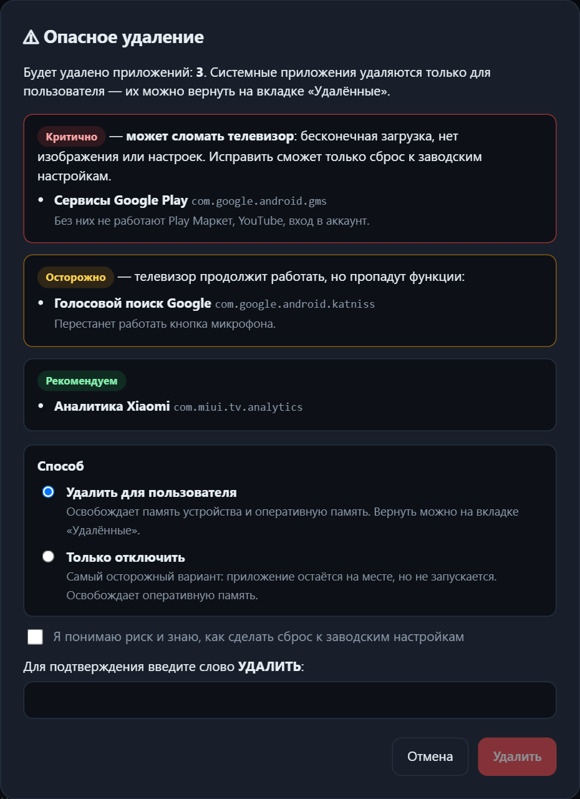
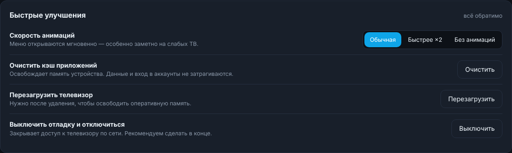
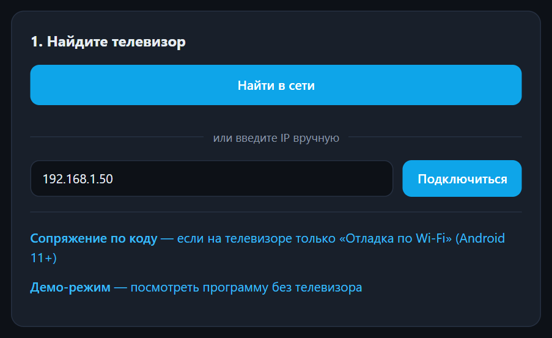

<div align="center">



[](https://github.com/Smrnw/UnbrakeTV/releases/latest)
[](https://github.com/Smrnw/UnbrakeTV/releases)


[](LICENSE)

**Программа для Windows, которая ускоряет телевизоры на Android TV и Google TV.**

Подключается к телевизору по сети, показывает, что его нагружает,<br>
и помогает безопасно убрать заводской мусор: рекламные оболочки, телеметрию и ненужные приложения.

**Один exe-файл · без adb.exe · без Python · без root · всё обратимо**

Нет телевизора под рукой? В программе есть **демо-режим** — можно посмотреть всё на встроенном эмуляторе.

### [⬇ Скачать UnbrakeTV.exe](https://github.com/Smrnw/UnbrakeTV/releases/latest/download/UnbrakeTV.exe)

<sub>Windows 10 / 11 · около 7 МБ · установка не нужна, просто запустите · [все версии](https://github.com/Smrnw/UnbrakeTV/releases)</sub>

</div>

---

## 📈 Видно, что тормозит

Процессор, оперативная память, память устройства и температура — в реальном времени. Программа показывает, какие приложения сейчас грузят телевизор, и подсказывает, что с этим сделать.



## ✅ Понятно, что можно удалить

Каждое приложение получает оценку с объяснением, что перестанет работать после удаления. Выбор — галочками.

| Оценка | Что значит |
|---|---|
| 🟢 **Рекомендуем удалить** | реклама, телеметрия, демо-режимы, промо-приложения — безопасно |
| 🔵 **Можно** | обычные приложения, удаляйте, если не пользуетесь |
| 🟡 **Осторожно** | телевизор будет работать, но пропадёт функция (голосовой поиск, эфир, обновления…) |
| 🟣 **Неизвестно** | компонент производителя без описания в базе знаний |
| 🔴 **Критично** | может сломать телевизор: бесконечная загрузка, нет изображения |



## 🛡 Защита от дурака



- **Осторожно** и **Неизвестно** — нужно подтвердить, что вы понимаете последствия.
- **Критично** — нужно отметить риск и ввести слово `УДАЛИТЬ`.
- Нельзя удалить последний рабочий стол — иначе после кнопки «Домой» будет пустой экран.
- Ядро Android и компонент, через который работает программа, удалить невозможно.
- Все проверки выполняются ещё раз внутри программы — обойти их через интерфейс нельзя.
- Можно не удалять, а **только отключить** приложение — самый осторожный вариант.
- Всё удалённое возвращается в один клик на вкладке **«Удалённые»**.

<br clear="right">

## 🚀 Быстрые улучшения



Ускорение анимаций в 2 раза, очистка кэша приложений, закрытие фоновых приложений, перезагрузка и выключение отладки после работы — одной кнопкой. После перезагрузки программа сама подключается к телевизору снова.

Любое прожорливое приложение можно остановить прямо из списка «Что сейчас нагружает телевизор», а карточка **«Результат этого сеанса»** показывает, сколько оперативной памяти и места на накопителе вы уже освободили.

## 🎯 Готовые профили

Не хочется разбираться в списке из сотни пакетов? Нажмите **«Готовые профили»** на вкладке «Приложения» и выберите набор:

| Профиль | Что отмечает |
|---|---|
| **Безопасная очистка** | всё, что база знаний считает рекламой, телеметрией и демо-режимом — подходит любому ТВ |
| **Xiaomi / Mi TV: без рекламы и слежки** | рекламные каналы PatchWall, аналитику и промо-контент; сам PatchWall остаётся |
| **Xiaomi / Mi TV: максимум скорости** | то же плюс сама оболочка PatchWall и зарубежные сервисы |
| **Android TV / Google TV: лишние сервисы Google** | YouTube Music, YouTube Kids, Play Фильмы, Play Игры, подсказки |
| **Сервисы, которые не работают в России** | Netflix, Prime Video, Disney+ и другие |
| **Демо-режим магазина и заглушки** | витринные ролики и тестовые заглушки |

Профиль только ставит галочки — вы видите, что выбрано, и подтверждаете удаление. Вся защита работает как обычно, а критичные компоненты в профили не попадают. Программа сама предложит профиль для вашей марки телевизора.

## 🏠 Лёгкий рабочий стол в один клик

Заводская оболочка с рекламой — главный источник тормозов. На вкладке **«Установка»** можно поставить лёгкий рабочий стол и сразу сделать его основным:

- **[Projectivy Launcher](https://github.com/spocky/miproja1)** — быстрый рабочий стол без рекламы, самая популярная замена PatchWall и главного экрана Google TV;
- **[FLauncher](https://github.com/osrosal/flauncher)** — минималистичный, с открытым исходным кодом.

Программа скачивает последнюю версию со страницы разработчика на GitHub, выбирает сборку под процессор телевизора, передаёт её на ТВ и устанавливает. Заводской рабочий стол остаётся на месте, пока вы сами его не удалите, — а программа по-прежнему не даст остаться без рабочего стола вообще.

Там же — **установка любого APK-файла** с компьютера: для приложений, которых нет в магазине телевизора.

## 📋 И ещё

- **Поиск телевизора в сети** — не нужно искать IP. VPN и прокси не дают ложных результатов. Телевизоры с «Отладкой по Wi-Fi» находятся автоматически.
- **Сопряжение по коду** — для телевизоров на Android 11+, где есть только «Отладка по Wi-Fi».
- **Демо-режим** — встроенный эмулятор телевизора: попробуйте программу, ничего не подключая и ничем не рискуя.
- **Профили** — сохраните список удалённого и примените его на другом телевизоре.
- **Отчёт о ТВ** — список всех пакетов вашей модели одним файлом, чтобы пополнить базу знаний.
- **Журнал** — что, когда и на каком телевизоре менялось.
- **Проверка обновлений** — программа сообщит, когда выйдет новая версия.
- **Ваши данные никуда не отправляются.** Интерфейс доступен только с вашего компьютера. В интернет программа обращается в двух случаях: при запуске спрашивает у GitHub номер последней версии (отключается галочкой на первом экране или ключом `-no-update-check`) и скачивает рабочий стол, когда вы сами нажимаете «Установить».

---

## Как пользоваться



1. На телевизоре: **Настройки → Об устройстве** → 7 раз нажмите на «Сборка».
2. **Настройки → Для разработчиков** → включите **«Отладка по USB»** (если её нет — [«Отладку по Wi-Fi»](#отладка-по-wi-fi-android-11)).
3. [Скачайте `UnbrakeTV.exe`](https://github.com/Smrnw/UnbrakeTV/releases/latest/download/UnbrakeTV.exe) и запустите — установка не нужна, интерфейс откроется в браузере.
4. Нажмите **«Найти в сети»** или введите IP телевизора.
5. На экране ТВ разрешите отладку (отметьте «Всегда разрешать»).
6. Отметьте лишнее → **«Удалить выбранные»** → перезагрузите ТВ.
7. В конце нажмите **«Выключить отладку»**.

<br clear="right">

### Отладка по Wi-Fi (Android 11+)

На новых телевизорах и приставках вместо «Отладки по USB» бывает только **«Отладка по Wi-Fi»**. Она требует один раз «познакомить» телевизор с компьютером:

1. На телевизоре: **Для разработчиков → Отладка по Wi-Fi** → включите и откройте **«Подключить устройство с помощью кода сопряжения»**. На экране появятся код из шести цифр, IP-адрес и порт.
2. В программе нажмите **«Сопряжение по коду»** (или «Найти в сети» — телевизор, ждущий сопряжения, появится в списке) и введите адрес с портом и код.
3. Программа выполнит сопряжение, сама найдёт порт подключения и подключится. Если порт не нашёлся, она попросит ввести его — он указан на экране «Отладка по Wi-Fi» в строке «IP-адрес и порт».

Сопряжение нужно один раз: дальше телевизор узнаёт компьютер сам. Порт подключения меняется после каждой перезагрузки ТВ — проще всего находить телевизор кнопкой «Найти в сети».

### Демо-режим

Нажмите **«Демо-режим»** на первом экране (или запустите `UnbrakeTV.exe -demo`). Программа подключится к встроенному эмулятору телевизора Xiaomi: можно удалять и возвращать приложения, применять профили, ставить рабочий стол и перезагружать «телевизор». Настоящие устройства не затрагиваются, журнал демо-сеанса не сохраняется, в интернет ничего не скачивается.

> [!NOTE]
> **Windows SmartScreen** может предупредить о неизвестном издателе — программа не подписана сертификатом. Нажмите «Подробнее» → «Выполнить в любом случае». Exe собирается автоматически в GitHub Actions из кода этого репозитория.

> [!TIP]
> **Телевизор не находится?** Если на компьютере включён VPN, выключите его на время работы — он может перехватывать подключения к домашней сети.

### Поддерживаемые устройства

✅ Android TV и Google TV: Xiaomi (PatchWall), Sony, TCL, Philips, Haier, Hisense на Android, Mi Box, Chromecast with Google TV, Nvidia Shield и другие.

❌ Samsung (Tizen), LG (webOS), Roku — на них нельзя удалять системные приложения.

🆕 «Отладка по Wi-Fi» с кодом сопряжения (Android 11+) поддерживается начиная с версии 1.1.0. Режим новый: если сопряжение на вашей модели не проходит, [сообщите об этом](https://github.com/Smrnw/UnbrakeTV/issues/new/choose) и используйте «Отладку по USB» — она тоже работает по сети.

## Как это работает

```
UnbrakeTV.exe ──HTTP 127.0.0.1──▶ браузер (интерфейс)
      │
      └──ADB по TCP:5555 (или ADB поверх TLS для «Отладки по Wi-Fi»)──▶ телевизор
             pm list packages, top, dumpsys diskstats   — сканирование и нагрузка
             pm uninstall -k --user 0 <pkg>             — удаление для пользователя
             pm disable-user --user 0 <pkg>             — отключение
             cmd package install-existing <pkg>         — восстановление
             sync: + pm install -r <apk>                — установка рабочего стола и APK
             cmd package set-home-activity <activity>   — выбор основного рабочего стола
             am kill-all, am force-stop <pkg>           — закрытие фоновых приложений
```

Системные приложения удаляются только для пользователя: файлы остаются в прошивке, поэтому всё возвращается из программы или сбросом к заводским настройкам.

Протокол ADB реализован внутри программы целиком: обычное подключение с RSA-ключом, сопряжение по коду (TLS 1.3 + SPAKE2 + AES-GCM, как в настоящем `adb pair`), передача файлов и поиск телевизоров через mDNS. Внешних библиотек нет — только стандартная библиотека Go.

Ключ ADB, журнал, список недавних телевизоров и настройки хранятся в `%APPDATA%\UnbrakeTV`.

### Параметры запуска

| Ключ | Что делает |
|---|---|
| `-demo` | сразу открыть демо-режим |
| `-no-update-check` | не проверять наличие новой версии при запуске |
| `-no-browser` | не открывать браузер автоматически |
| `-port N` | порт веб-интерфейса (по умолчанию случайный) |

## Сборка из исходников

Нужен Go 1.22+, внешних зависимостей нет.

```bash
go vet ./... && go test ./...
GOOS=windows GOARCH=amd64 CGO_ENABLED=0 go build -trimpath -ldflags "-s -w" -o distr/UnbrakeTV.exe .
# или на Windows: build.bat
```

### Тестовый стенд

Для разработки без телевизора есть эмулятор, который говорит по настоящему протоколу ADB (он же работает в демо-режиме):

```bash
# обычная «Отладка по USB» по сети
go run ./cmd/fakeadb -listen 127.0.0.1:5555

# «Отладка по Wi-Fi»: TLS и сопряжение по коду
go run ./cmd/fakeadb -listen 127.0.0.1:37555 -wireless -pair 127.0.0.1:37556 -code 123456
```

Автотесты (`go test ./...`) прогоняют через эмулятор весь путь: подключение, сопряжение, удаление с проверками защиты, восстановление, установку APK и перезагрузку.

## Ошибки и предложения

Нашли ошибку или знаете, что за пакет стоит на вашем телевизоре? [Создайте issue](https://github.com/Smrnw/UnbrakeTV/issues/new/choose) с моделью ТВ и отчётом (вкладка «Приложения» → «Отчёт о ТВ») — так база знаний и готовые профили пополняются новыми моделями.

## Планы

- Готовые профили для Sony, TCL, Hisense, Philips и Haier — нужны ваши отчёты о ТВ
- Резервная копия APK перед удалением приложений, установленных пользователем
- Обновление базы знаний без выпуска новой версии программы
- Пульт на экране компьютера: навигация по телевизору мышью и клавиатурой
- Версии для macOS и Linux

## Лицензия

© 2026 [Smrnw](https://github.com/Smrnw). [PolyForm Noncommercial 1.0.0](LICENSE).

- ✅ бесплатно для личного, учебного, исследовательского и некоммерческого использования;
- ❌ продажа, перепродажа, ребрендинг, платные услуги (например, настройка или «ускорение» телевизоров за деньги) и любое другое коммерческое использование — только по отдельной письменной лицензии от автора.

По вопросам коммерческой лицензии пишите через [GitHub](https://github.com/Smrnw).

> [!WARNING]
> Вы меняете системное ПО своего устройства на свой риск. Всё, что удаляет программа, можно вернуть, но удаление критичных компонентов может потребовать сброса к заводским настройкам.
